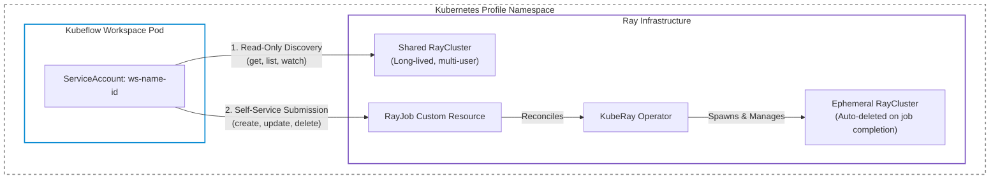



This guide shows **platform administrators** and **cluster operators** how to configure [Kubeflow Workspaces](/docs/components/workspaces/overview/) to run distributed Ray workloads using [KubeRay](https://docs.ray.io/en/latest/cluster/kubernetes/index.html).

After completing the steps in this guide, any workspace created from the configured `WorkspaceKind` (such as JupyterLab or VS Code) can securely interact with Ray clusters and self-serve on-demand distributed Ray jobs without needing cluster administrator privileges or `kubectl` access.

{}
If you are a data scientist or ML engineer looking to run Ray workloads from a workspace notebook, see the user guide: **[How to use Ray with Kubeflow Workspaces](/docs/components/workspaces/user-guides/ray/)**.
{}

---

## Architecture and Security Model

Kubeflow Workspaces runs interactive development environments (such as JupyterLab) in dedicated Kubernetes pods. Each workspace pod runs with a dedicated Kubernetes `ServiceAccount` (`ws-<workspace-name>-<suffix>`).

Integrating Kubeflow Workspaces with KubeRay supports two primary workload patterns:

| Workload Pattern | Description | Cluster Lifecycle | Security / RBAC Boundary |
| :--- | :--- | :--- | :--- |
| **Interactive Prototyping** | Connect from a notebook to a shared `RayCluster` for exploratory data analysis, interactive debugging, and distributed development. | Long-lived, shared cluster managed by the administrator. | **Read-only** access to `RayCluster` resources (discover and connect; cannot create or delete). |
| **On-Demand Batch Jobs** | Submit an on-demand distributed training or data processing run via a `RayJob` custom resource. | Ephemeral cluster provisioned automatically per job and deleted upon job completion. | **Full access** to `RayJob` custom resources (create, update, delete, watch). |



### Why Least-Privilege RBAC Matters

A common operational pitfall is granting workspace pods full permissions to create unmanaged `RayCluster` resources. Because a `RayCluster` created directly from an interactive notebook has no lifecycle link to the workspace pod, any crash, closed browser tab, or forgotten workspace leaves expensive worker nodes (including GPUs) running indefinitely.

To prevent resource leaks and maximize cluster utilization, the RBAC model configured below enforces:
- **`RayJob`: full access (`create`, `update`, `patch`, `delete`, `get`, `list`, `watch`).** Users can launch on-demand training and batch jobs. The KubeRay operator automatically cleans up the underlying `RayCluster` and pods when the job finishes.
- **`RayCluster`: read-only access (`get`, `list`, `watch`).** Users can discover and connect to pre-provisioned shared clusters, but cannot spin up untracked, unmanaged `RayCluster` instances directly.

---

## Prerequisites

Before configuring KubeRay for Kubeflow Workspaces, ensure you have:

- A Kubernetes cluster (v1.28 or later) with [Kubeflow Workspaces installed](/docs/components/workspaces/operator-guides/deployment-guide/).
- Cluster administrator privileges (`cluster-admin`) and `kubectl` configured.
- [Helm v3](https://helm.sh/) installed (if installing KubeRay via Helm).

---

## Step 1: Install the KubeRay Operator

The on-demand job workflow utilizes `RayJob` `InteractiveMode`, which requires **KubeRay v1.3 or later**.

Choose one of the following installation methods:

### Option A: Install via Official KubeRay Guide (Recommended)

Follow the official [KubeRay Operator Installation Guide](https://docs.ray.io/en/latest/cluster/kubernetes/getting-started/kuberay-operator-installation.html) to install the operator (for example, using Helm).

### Option B: Install via Kubeflow Community Distribution

If you deploy the [Kubeflow Community Distribution](https://github.com/kubeflow/community-distribution), you can install KubeRay using the [community distribution](https://github.com/kubeflow/community-distribution/tree/master/experimental/ray) (or by uncommenting `../experimental/ray/kuberay-operator/overlays/kubeflow` in [`example/kustomization.yaml`](https://github.com/kubeflow/community-distribution/blob/master/example/kustomization.yaml)). Then you also get proper support for Istio sidecars by default.

### Verify the Installation

Verify that the KubeRay operator pod is running:

```bash
kubectl get pods -A -l app.kubernetes.io/name=kuberay-operator
```

---

## Step 2: Configure RBAC Permissions for WorkspaceKind

Each workspace pod created by Kubeflow Workspaces runs as a dedicated `ServiceAccount` (`ws-<workspace-name>-<suffix>`). Rather than manually binding roles per workspace or user, define a `ClusterRole` once and attach it to the `WorkspaceKind`. The Workspaces controller then binds it automatically for every workspace created from that kind.

### 1. Create the `ray-job-edit` ClusterRole

Apply the following `ClusterRole` manifest:

```yaml
apiVersion: rbac.authorization.k8s.io/v1
kind: ClusterRole
metadata:
  name: ray-job-edit
rules:
  # Discover and connect to shared Ray clusters (read-only; no create/delete)
  - apiGroups: ["ray.io"]
    resources: ["rayclusters", "rayclusters/status"]
    verbs: ["get", "list", "watch"]
  # Self-service, self-cleaning on-demand jobs (full lifecycle access)
  - apiGroups: ["ray.io"]
    resources: ["rayjobs", "rayjobs/status"]
    verbs: ["get", "list", "watch", "create", "update", "patch", "delete"]
  # Pod status checks and log streaming
  - apiGroups: [""]
    resources: ["pods", "pods/log", "services", "events"]
    verbs: ["get", "list", "watch"]
```

Save this as `ray-job-edit.yaml` and apply it:
```bash
kubectl apply -f ray-job-edit.yaml
```

---

### 2. Bind the ClusterRole to the WorkspaceKind

Add `ray-job-edit` to `spec.podTemplate.serviceAccount.clusterRoles` in the target `WorkspaceKind` (for example, `jupyterlab`):

```yaml
apiVersion: kubeflow.org/v1beta1
kind: WorkspaceKind
metadata:
  name: jupyterlab
spec:
  podTemplate:
    serviceAccount:
      clusterRoles:
        - name: ray-job-edit
```

#### Patch an Existing WorkspaceKind

To add `ray-job-edit` to an existing `WorkspaceKind` (such as the default upstream `jupyterlab` sample):

```bash
kubectl patch workspacekind jupyterlab --type=json -p='[
  {"op": "add", "path": "/spec/podTemplate/serviceAccount/clusterRoles/-", "value": {"name": "ray-job-edit"}}
]'
```

Or, if `clusterRoles` is currently empty, use a merge patch:

```bash
kubectl patch workspacekind jupyterlab --type=merge -p='{
  "spec": {
    "podTemplate": {
      "serviceAccount": {
        "clusterRoles": [
          {"name": "ray-job-edit"}
        ]
      }
    }
  }
}'
```

---

## Step 3: Provision Shared Ray Clusters for Interactive Prototyping

Interactive users connect to a long-lived `RayCluster` running in their namespace. Because workspace users do not have permissions to create `RayCluster` resources directly, platform administrators must provision shared clusters.

To create a `RayCluster`, follow the official [RayCluster Quickstart](https://docs.ray.io/en/latest/cluster/kubernetes/getting-started/raycluster-quick-start.html).

### Recommendations for Kubeflow Workspaces

When provisioning a shared Ray cluster for workspace users, keep the following in mind:

- **Autoscaling**: Set `minReplicas: 0` in `workerGroupSpecs` so idle worker pods automatically scale down to zero when users are not actively executing distributed tasks.
- **Istio sidecar bypass**: If you have not installed via the [community distribution](https://github.com/kubeflow/community-distribution/tree/master/experimental/ray) then you do not have full Istio support and need to add `sidecar.istio.io/inject: "false"` to the labels of both head and worker pod templates to prevent Istio from intercepting Ray's internal gRPC communication (see [Handling Istio Sidecars with Ray](#1-handling-istio-sidecars-with-ray)).
- **Version matching**: Select a Ray container image whose Ray version and Python minor version match your workspace images.

### What to Communicate to Workspace Users

Once provisioned, inform your workspace users of:
1. **Configured `WorkspaceKind`**: Which `WorkspaceKind` (e.g., `jupyterlab`) has the `ray-job-edit` role bound, so users select the correct template when launching their workspace.
2. **Ray Version**: The version installed on the cluster, so users install the matching client SDK in their notebook.
3. **Python Version**: The Python minor version of the Ray image (e.g., `3.11`, `3.12`), so workspace notebooks run a compatible Python environment.
4. **Cluster Name**: (e.g., `shared-ray-cluster`) The name of the shared cluster for interactive users.

---

## Network and Infrastructure Considerations

### 1. Handling Istio Sidecars with Ray

Kubeflow profiles enable Istio sidecar injection by default in user namespaces. Envoy sidecars intercept and buffer internal gRPC communication between the Ray head and worker nodes. If you have installed via the [community distribution](https://github.com/kubeflow/community-distribution/tree/master/experimental/ray) then you have proper Istio support. If not you have to disable the mesh integration since otherwise the Ray cluster initialization will fail or hang indefinitely.

| Approach | When to Use | How to Implement |
| :--- | :--- | :--- |
| **Bypass Injection (Recommended)** | Standard Kubeflow deployments where internal Ray cluster traffic does not require mutual TLS. | Add label `sidecar.istio.io/inject: "false"` to the pod templates of `RayCluster` and `RayJob`. |
| **Service Mesh Integration** | Clusters with strict security policies requiring mTLS on all pods across the cluster. | Configure headless Kubernetes services, explicit Ray ports, `node-ip-address`, and Istio `AuthorizationPolicy`. See [`experimental/ray/raycluster_example.yaml`](https://github.com/kubeflow/community-distribution/blob/master/experimental/ray/raycluster_example.yaml) for a complete example. |

### 2. Enforcing Namespace Resource Quotas

Because users have permission to create `RayJob` resources, configure a Kubernetes [`ResourceQuota`](https://kubernetes.io/docs/concepts/policy/resource-quotas/) per profile namespace to prevent a single user or runaway job from exhausting cluster compute (CPU, memory, GPUs):

```yaml
apiVersion: v1
kind: ResourceQuota
metadata:
  name: ray-compute-quota
  namespace: <user-namespace>
spec:
  hard:
    requests.cpu: "32"
    requests.memory: "128Gi"
    requests.nvidia.com/gpu: "4"
    limits.cpu: "64"
    limits.memory: "256Gi"
    limits.nvidia.com/gpu: "4"
```

### 3. Python and Ray Version Matching Policy

Ray Client requires that the **Ray minor version** and **Python minor version** match identically between the client (the workspace image) and the server (the Ray head/worker image).
- Ensure your `WorkspaceKind` container images and the Ray cluster images use the same Python minor version (e.g., Python 3.12).
- Publish standard image tags for users (e.g., `rayproject/ray:2.58.0-py312`).

---

## Troubleshooting Operator Issues

### Symptom: Workspace Users Receive `403 Forbidden` When Interacting with Ray

* **Likely Cause**: The workspace's `ServiceAccount` lacks the `ray-job-edit` `ClusterRole`.
* **Verification**:
  ```bash
  kubectl auth can-i create rayjobs \
    --as=system:serviceaccount:<namespace>:ws-<workspace-name>-<id> \
    -n <namespace>
  ```
* **Resolution**: Ensure `ray-job-edit` is added to `spec.podTemplate.serviceAccount.clusterRoles` in the `WorkspaceKind` and re-create the workspace pod.

### Symptom: Ray Clusters Remain in `Pending` or Head Pod Never Becomes Ready

* **Likely Cause 1 (Istio)**: You have installed without proper Istio support and the Envoy sidecar is intercepting Ray's internal gRPC ports. Verify whether `sidecar.istio.io/inject: "false"` is present in the head and worker pod templates.
* **Likely Cause 2 (Resources)**: The cluster lacks available CPU, memory, or GPU capacity to schedule the requested pods, or the requested resources exceed the namespace `ResourceQuota`. Check `kubectl describe raycluster <name> -n <namespace>` and `kubectl get events -n <namespace>`.

---

## Next Steps

- Share the **[User Guide: How to use Ray with Kubeflow Workspaces](/docs/components/workspaces/user-guides/ray/)** with your data scientists and ML engineers.
- Read the [Kubeflow Workspaces Deployment Guide](/docs/components/workspaces/operator-guides/deployment-guide/) to customize additional `WorkspaceKind` templates.
- Consult the [KubeRay Official Documentation](https://docs.ray.io/en/latest/cluster/kubernetes/index.html) for advanced cluster autoscaler, GCS fault-tolerance, and observability configurations.
