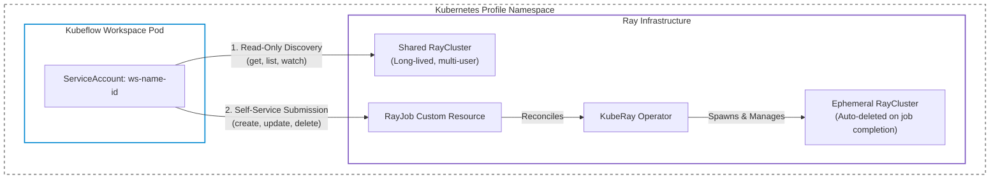



This guide shows **platform administrators** and **cluster operators** how to configure [Kubeflow Workspaces](/docs/components/workspaces/overview/) to run distributed Ray workloads using [KubeRay](https://docs.ray.io/en/latest/cluster/kubernetes/index.html).

After completing the steps in this guide, any workspace created from the configured `WorkspaceKind` (such as JupyterLab or VS Code) can securely interact with Ray clusters and self-serve on-demand distributed Ray jobs without needing cluster administrator privileges or `kubectl` access.

{}
If you are a data scientist or ML engineer looking to run Ray workloads from a workspace notebook, see the user guide: **[How to use Ray with Kubeflow Workspaces](/docs/components/workspaces/user-guides/ray/)**.
{}

---

## Architecture and Security Model

Kubeflow Workspaces runs interactive development environments (such as JupyterLab) in dedicated Kubernetes pods. Each workspace pod runs with a dedicated Kubernetes `ServiceAccount` (`ws-<workspace-name>-<suffix>`).

Integrating Kubeflow Workspaces with KubeRay supports two primary workload patterns:

| Workload Pattern | Description | Cluster Lifecycle | Security / RBAC Boundary |
| :--- | :--- | :--- | :--- |
| **Interactive Prototyping** | Connect from a notebook to a shared `RayCluster` for exploratory data analysis, interactive debugging, and distributed development. | Long-lived, shared cluster managed by the administrator. | **Read-only** Kubernetes RBAC on `RayCluster` resources (discover only; cannot create or delete). Ray Client connections still execute code inside the Ray pods. |
| **On-Demand Batch Jobs** | Submit an on-demand distributed training or data processing run via a `RayJob` custom resource. | Ephemeral cluster provisioned automatically per job and deleted upon job completion. | **Full access** to `RayJob` custom resources (create, update, delete, watch). |

{}
Read-only Kubernetes RBAC on `RayCluster` (`get`, `list`, `watch`) does **not** make Ray Client (`ray.init()`) access read-only. Any user who can connect to a shared `RayCluster` executes arbitrary code inside its Ray pods and can access the pods' `ServiceAccount` credentials and data. Only share a `RayCluster` among mutually trusted users with a minimally privileged Ray `ServiceAccount`, and provision separate clusters or namespaces where users require isolation.
{}



### Why Least-Privilege RBAC Matters

A common operational pitfall is granting workspace pods full permissions to create unmanaged `RayCluster` resources. Because a `RayCluster` created directly from an interactive notebook has no lifecycle link to the workspace pod, any crash, closed browser tab, or forgotten workspace leaves expensive worker nodes (including GPUs) running indefinitely.

To reduce resource leaks and improve cluster utilization, the RBAC model configured below separates permissions as follows:
- **`RayJob`: full lifecycle access (`create`, `update`, `patch`, `delete`, `get`, `list`, `watch`).** Users can launch on-demand training and batch jobs. When a `RayJob` sets `shutdownAfterJobFinishes: true` (as in the user guide's helper), the KubeRay operator cleans up the underlying `RayCluster` and worker pods when the job finishes. Note that RBAC alone does not enforce this setting: a user can omit `shutdownAfterJobFinishes` or set it to `false`, leaving the cluster running after completion. If preventing resource leaks is a hard operator requirement, enforce `shutdownAfterJobFinishes`, `ttlSecondsAfterFinished`, and `activeDeadlineSeconds` via a Kubernetes admission policy (such as `ValidatingAdmissionPolicy`, Kyverno, or OPA Gatekeeper) or configure a KubeRay deletion strategy.
- **`RayCluster`: read-only access (`get`, `list`, `watch`).** Users can discover pre-provisioned shared clusters, but cannot spin up untracked, unmanaged `RayCluster` instances directly.

---

## Prerequisites

Before configuring KubeRay for Kubeflow Workspaces, ensure you have:

- A Kubernetes cluster (v1.28 or later) with [Kubeflow Workspaces installed](/docs/components/workspaces/operator-guides/deployment-guide/).
- Cluster administrator privileges (`cluster-admin`) and `kubectl` configured.
- [Helm v3](https://helm.sh/) installed (if installing KubeRay via Helm).

---

## Step 1: Install the KubeRay Operator

The on-demand job workflow utilizes `RayJob` `InteractiveMode`, which requires **KubeRay v1.3 or later**.

Choose one of the following installation methods:

### Option A: Install via Official KubeRay Guide (Recommended)

Follow the official [KubeRay Operator Installation Guide](https://docs.ray.io/en/latest/cluster/kubernetes/getting-started/kuberay-operator-installation.html) to install the operator (for example, using Helm).

### Option B: Install via Kubeflow Community Distribution

If you deploy the [Kubeflow Community Distribution](https://github.com/kubeflow/community-distribution), you can install KubeRay using the [community distribution](https://github.com/kubeflow/community-distribution/tree/master/experimental/ray) (or by uncommenting `../experimental/ray/kuberay-operator/overlays/kubeflow` in [`example/kustomization.yaml`](https://github.com/kubeflow/community-distribution/blob/master/example/kustomization.yaml)). That directory also includes an example `RayCluster` and `AuthorizationPolicy` showing how to configure per-cluster networking for Istio sidecars.

### Verify the Installation

Verify that the KubeRay operator pod is running:

```bash
kubectl get pods -A -l app.kubernetes.io/name=kuberay-operator
```

---

## Step 2: Configure RBAC Permissions for WorkspaceKind

Each workspace pod created by Kubeflow Workspaces runs as a dedicated `ServiceAccount` (`ws-<workspace-name>-<suffix>`). Rather than manually binding roles per workspace or user, define a `ClusterRole` once and attach it to the `WorkspaceKind`. The Workspaces controller then binds it automatically for every workspace created from that kind.

### 1. Create the `ray-job-edit` ClusterRole

{}
Creating or patching a `RayJob` allows the caller to specify head and worker pod templates (`rayClusterSpec.headGroupSpec.template` and `workerGroupSpecs[].template`), including `serviceAccountName` and `Secret` volume mounts. Without admission-policy restrictions on these templates, the KubeRay operator can start pods using namespace credentials that the workspace `ServiceAccount` cannot access directly. Either enforce admission policies restricting `RayJob` pod templates or limit `ray-job-edit` to fully trusted users.
{}

Apply the following `ClusterRole` manifest:

```yaml
apiVersion: rbac.authorization.k8s.io/v1
kind: ClusterRole
metadata:
  name: ray-job-edit
rules:
  # Discover and connect to shared Ray clusters (read-only; no create/delete)
  - apiGroups: ["ray.io"]
    resources: ["rayclusters", "rayclusters/status"]
    verbs: ["get", "list", "watch"]
  # Self-service, self-cleaning on-demand jobs (full lifecycle access)
  - apiGroups: ["ray.io"]
    resources: ["rayjobs"]
    verbs: ["get", "list", "watch", "create", "update", "patch", "delete"]
  - apiGroups: ["ray.io"]
    resources: ["rayjobs/status"]
    verbs: ["get"]
  # Pod status checks and service discovery (job logs are streamed via Ray Dashboard)
  - apiGroups: [""]
    resources: ["pods", "services", "events"]
    verbs: ["get", "list", "watch"]
```

Save this as `ray-job-edit.yaml` and apply it:
```bash
kubectl apply -f ray-job-edit.yaml
```

---

### 2. Bind the ClusterRole to the WorkspaceKind

Add `ray-job-edit` to `spec.podTemplate.serviceAccount.clusterRoles` in the target `WorkspaceKind` (for example, `jupyterlab`):

```yaml
apiVersion: kubeflow.org/v1beta1
kind: WorkspaceKind
metadata:
  name: jupyterlab
spec:
  podTemplate:
    serviceAccount:
      clusterRoles:
        - name: ray-job-edit
```

#### Patch an Existing WorkspaceKind

If `serviceAccount` or `clusterRoles` is not yet defined on your `WorkspaceKind` (such as the default upstream `jupyterlab` sample), initialize `clusterRoles` using a merge patch:

```bash
kubectl patch workspacekind jupyterlab --type=merge -p='{
  "spec": {
    "podTemplate": {
      "serviceAccount": {
        "clusterRoles": [
          {"name": "ray-job-edit"}
        ]
      }
    }
  }
}'
```

If `serviceAccount.clusterRoles` already exists and you want to append `ray-job-edit` without replacing existing grants, use a JSON patch (note that this requires `serviceAccount.clusterRoles` to already be present as an array):

```bash
kubectl patch workspacekind jupyterlab --type=json -p='[
  {"op": "add", "path": "/spec/podTemplate/serviceAccount/clusterRoles/-", "value": {"name": "ray-job-edit"}}
]'
```

---

## Step 3: Provision Shared Ray Clusters for Interactive Prototyping

Interactive users connect to a long-lived `RayCluster` running in their namespace. Because workspace users do not have permissions to create `RayCluster` resources directly, platform administrators must provision shared clusters.

To create a `RayCluster`, follow the official [RayCluster Quickstart](https://docs.ray.io/en/latest/cluster/kubernetes/getting-started/raycluster-quick-start.html).

### Recommendations for Kubeflow Workspaces

When provisioning a shared Ray cluster for workspace users, keep the following in mind:

- **Autoscaling**: Enable Ray's autoscaler by setting `spec.enableInTreeAutoscaling: true` on the `RayCluster` and set `minReplicas: 0` in `workerGroupSpecs` so idle worker pods automatically scale down to zero when users are not actively executing distributed tasks. Note that setting `minReplicas: 0` alone does not enable autoscaling; without `enableInTreeAutoscaling: true`, worker replicas remain running while idle. For details, see the KubeRay [RayCluster Autoscaler documentation](https://docs.ray.io/en/latest/cluster/kubernetes/user-guides/kuberay-autoscaler.html).
- **Istio sidecar bypass**: Unless your `RayCluster` specs and supporting services are explicitly configured for Istio service mesh (see [Handling Istio Sidecars with Ray](#1-handling-istio-sidecars-with-ray)), add `sidecar.istio.io/inject: "false"` to the labels of both head and worker pod templates to prevent Istio from intercepting Ray's internal gRPC communication, and enforce `NetworkPolicy` ingress isolation on the Ray pods.
- **Version matching**: Select a Ray container image whose exact Ray version and Python minor version match your workspace images.

### What to Communicate to Workspace Users

Once provisioned, inform your workspace users of:
1. **Configured `WorkspaceKind`**: Which `WorkspaceKind` (e.g., `jupyterlab`) has the `ray-job-edit` role bound, so users select the correct template when launching their workspace.
2. **Ray Version**: The version installed on the cluster, so users install the matching client SDK in their notebook.
3. **Python Version**: The Python minor version of the Ray image (e.g., `3.11`, `3.12`), so workspace notebooks run a compatible Python environment.
4. **Cluster Name**: (e.g., `shared-ray-cluster`) The name of the shared cluster for interactive users.

---

## Network and Infrastructure Considerations

### 1. Handling Istio Sidecars with Ray

Kubeflow profiles enable Istio sidecar injection by default in user namespaces. Envoy sidecars intercept and buffer internal gRPC communication between the Ray head and worker nodes. Unless your `RayCluster` and `RayJob` manifests and supporting Kubernetes services are explicitly configured for the Istio service mesh (as shown in [`experimental/ray/raycluster_example.yaml`](https://github.com/kubeflow/community-distribution/blob/master/experimental/ray/raycluster_example.yaml)), you must disable sidecar injection on Ray pods; otherwise Ray cluster initialization will fail or hang indefinitely.

| Approach | When to Use | How to Implement |
| :--- | :--- | :--- |
| **Bypass Injection (Recommended with NetworkPolicy)** | Deployments where per-cluster Istio mesh networking is not configured on Ray clusters and internal Ray traffic does not require mutual TLS. | Add label `sidecar.istio.io/inject: "false"` to the pod templates of `RayCluster` and `RayJob`, **and** enforce Kubernetes `NetworkPolicy` ingress rules. |
| **Service Mesh Integration** | Clusters with strict security policies requiring mTLS on all pods across the cluster. | Configure headless Kubernetes services, explicit Ray ports, `node-ip-address`, and Istio `AuthorizationPolicy`. See [`experimental/ray/raycluster_example.yaml`](https://github.com/kubeflow/community-distribution/blob/master/experimental/ray/raycluster_example.yaml) for a starting configuration. |

{}
Bypassing sidecar injection (`sidecar.istio.io/inject: "false"`) also bypasses Istio `AuthorizationPolicy` enforcement on the Ray head pod. Without an enforced network restriction, any reachable pod in the cluster can use the unauthenticated Ray Client (`10001`) and Dashboard (`8265`) endpoints to execute code on the Ray cluster. Before enabling this bypass, enforce Kubernetes `NetworkPolicy` ingress isolation so only trusted workspace pods, Ray cluster pods, and the KubeRay operator can reach the Ray head pod.
{}

{}
The example [`experimental/ray/raycluster_example.yaml`](https://github.com/kubeflow/community-distribution/blob/master/experimental/ray/raycluster_example.yaml) allows `default-editor` and internal Ray cluster ports.

When Kubeflow Workspaces use dedicated service accounts (`ws-<workspace-name>-<suffix>`), workspace requests to Ray Client (port `10001`) and Ray Dashboard (port `8265`) will be denied by default. In addition, the separately deployed KubeRay operator needs access to the Ray Dashboard (port `8265`) to track `RayJob` completion and perform cleanup. Update or augment the `AuthorizationPolicy` to permit Ray's own pods, the KubeRay operator (which must carry an Istio mTLS identity via an injected sidecar for principal matching to succeed), and workspace service account principals:

```yaml
apiVersion: security.istio.io/v1beta1
kind: AuthorizationPolicy
metadata:
  name: ray-cluster-workspace-access
  namespace: <user-namespace>
spec:
  selector:
    matchLabels:
      ray.io/node-type: head
  action: ALLOW
  rules:
    # Allow Ray worker/head pods
    - from:
        - source:
            principals: ["cluster.local/ns/<user-namespace>/sa/<ray-head-worker-sa>"]
    # Allow KubeRay operator on Ray Dashboard port for RayJob tracking and cleanup
    - from:
        - source:
            principals: ["cluster.local/ns/<kuberay-operator-namespace>/sa/<kuberay-operator-sa>"]
      to:
        - operation:
            ports: ["8265"]
    # Allow workspace service accounts on Ray Client and Dashboard ports
    - from:
        - source:
            principals: ["cluster.local/ns/<user-namespace>/sa/ws-*"]
      to:
        - operation:
            ports: ["10001", "8265"]
```
{}

### 2. Enforcing Namespace Resource Quotas

Because users have permission to create `RayJob` resources, configure a Kubernetes [`ResourceQuota`](https://kubernetes.io/docs/concepts/policy/resource-quotas/) per profile namespace to prevent a single user or runaway job from exhausting cluster compute (CPU, memory, GPUs):

```yaml
apiVersion: v1
kind: ResourceQuota
metadata:
  name: ray-compute-quota
  namespace: <user-namespace>
spec:
  hard:
    requests.cpu: "32"
    requests.memory: "128Gi"
    requests.nvidia.com/gpu: "4"
    limits.cpu: "64"
    limits.memory: "256Gi"
    limits.nvidia.com/gpu: "4"
```

### 3. Python and Ray Version Matching Policy

Ray Client requires that the **exact Ray version** (including patch version, e.g., `2.58.0`) and **Python minor version** (e.g., `3.12`) match identically between the client (the workspace image) and the server (the Ray head/worker image). While Python allows different patch versions (e.g., Python 3.12.1 vs 3.12.2), Ray Client checks the full Ray version string and raises a version-mismatch error at `ray.init()` if the versions differ.
- Ensure your `WorkspaceKind` container images and the Ray cluster images use the identical Ray version (e.g., Ray 2.58.0) and the same Python minor version (e.g., Python 3.12).
- Publish standard image tags for users (e.g., `rayproject/ray:2.58.0-py312`).

---

## Troubleshooting Operator Issues

### Symptom: Workspace Users Receive `403 Forbidden` When Interacting with Ray

* **Likely Cause**: The workspace's `ServiceAccount` lacks the `ray-job-edit` `ClusterRole`.
* **Verification**:
  ```bash
  kubectl auth can-i create rayjobs \
    --as=system:serviceaccount:<namespace>:ws-<workspace-name>-<id> \
    -n <namespace>
  ```
* **Resolution**: Ensure `ray-job-edit` is added to `spec.podTemplate.serviceAccount.clusterRoles` in the `WorkspaceKind` and wait for the Workspaces controller to reconcile the workspace's `RoleBinding` (existing workspace pods do not need to be recreated).

### Symptom: Ray Clusters Remain in `Pending` or Head Pod Never Becomes Ready

* **Likely Cause 1 (Istio)**: Istio sidecar injection is enabled on the Ray pods without the required per-cluster service mesh configuration, and the Envoy sidecar is intercepting Ray's internal gRPC ports. Verify whether `sidecar.istio.io/inject: "false"` is present in the head and worker pod templates (or whether full mesh networking is configured).
* **Likely Cause 2 (Resources)**: The cluster lacks available CPU, memory, or GPU capacity to schedule the requested pods, or the requested resources exceed the namespace `ResourceQuota`. Check `kubectl describe raycluster <name> -n <namespace>` and `kubectl get events -n <namespace>`.

---

## Next Steps

- Share the **[User Guide: How to use Ray with Kubeflow Workspaces](/docs/components/workspaces/user-guides/ray/)** with your data scientists and ML engineers.
- Read the [Kubeflow Workspaces Deployment Guide](/docs/components/workspaces/operator-guides/deployment-guide/) to customize additional `WorkspaceKind` templates.
- Consult the [KubeRay Official Documentation](https://docs.ray.io/en/latest/cluster/kubernetes/index.html) for advanced cluster autoscaler, GCS fault-tolerance, and observability configurations.
