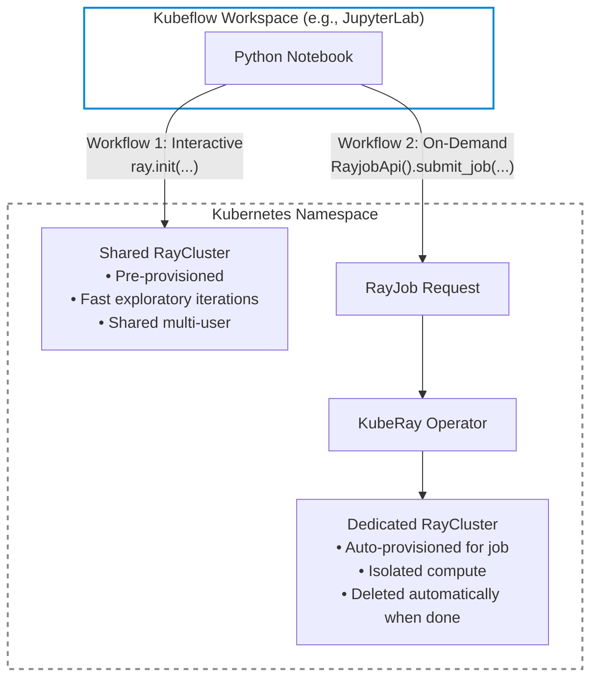



This guide shows **machine learning researchers**, **data scientists**, and **developers** how to scale out Python workloads from a [Kubeflow Workspace](/docs/components/workspaces/overview/) (such as a JupyterLab notebook) to distributed compute clusters using [Ray](https://docs.ray.io/) and [KubeRay](https://ray-project.github.io/kuberay/).

Kubeflow Workspaces provide interactive, containerized development environments on Kubernetes. When a workload outgrows a single notebook pod—such as large-scale data preprocessing, hyperparameter sweeps, or distributed model training—you can offload execution directly to Ray clusters from Python, with no `kubectl` or Kubernetes expertise required.

{}
Before you begin, your platform administrator must install the KubeRay operator and grant workspace permissions as described in **[How to enable Ray for Workspaces](/docs/components/workspaces/operator-guides/kuberay/)**.
{}

---

## Overview: Two Ways to Run Ray from a Workspace

Depending on your task, you can interact with Ray using two distinct workflows:

| Workflow | Best For | Cluster Management | Resource Cleanup |
| :--- | :--- | :--- | :--- |
| **[Workflow 1: Interactive Computing](#workflow-1-interactive-computing-on-a-shared-ray-cluster)** | Exploratory analysis, step-by-step notebook debugging, prototyping | Connect to an existing, long-lived `RayCluster` managed by your administrator | The cluster remains running for you and other users |
| **[Workflow 2: On-Demand Jobs](#workflow-2-on-demand-jobs-with-rayjob)** | Batch training, large pipelines, parameter sweeps needing dedicated compute | Ephemeral cluster provisioned automatically via a `RayJob` custom resource | **Automatic**: KubeRay deletes the cluster when the job finishes |



---

## Prerequisites and Environment Setup

### 1. Required Information from Your Administrator

Before creating your workspace or running code, ask your platform administrator for:

1. **Which `WorkspaceKind` to select**: Your workspace must be created from a `WorkspaceKind` (for example, `jupyterlab`) configured with Ray RBAC permissions (`ray-job-edit`). If created from an unconfigured kind, your workspace will not have permission to interact with Ray.
2. **The Ray and Python versions**: The exact Ray version (e.g., `2.58.0`) and Python minor version (e.g., `3.12`) running on the cluster. Ray Client requires identical Ray and Python minor versions between your workspace environment and the Ray cluster.
3. **The name of the shared Ray cluster**: If you plan to use [Workflow 1: Interactive Computing](#workflow-1-interactive-computing-on-a-shared-ray-cluster). (If unknown, you can also [discover it programmatically](#step-1-discover-available-shared-ray-clusters)).

---

### 2. Install Ray and the KubeRay Python Client

Run the following in a notebook cell or terminal inside your workspace:

```bash
RAY_VERSION="2.58.0"

# Install ray and kuberay-client (using git until published to PyPI as kuberay-client)
pip install "ray[default,client]==${RAY_VERSION}" \
  "git+https://github.com/kuberay-project/kuberay.git#subdirectory=clients/kuberay-client"
```

{}
If you install packages inside a running notebook, restart the kernel (**Kernel ➔ Restart Kernel**) before importing the newly installed libraries.
{}

---

### 3. Determine Your Workspace Namespace

All workspace operations run inside your Kubernetes project namespace. Fetch the current namespace automatically from the pod's service account secret:

```python
def get_current_namespace() -> str:
    """Return the Kubernetes namespace this workspace pod is running in."""
    with open("/var/run/secrets/kubernetes.io/serviceaccount/namespace") as f:
        return f.read().strip()


NAMESPACE = get_current_namespace()
print(f"Workspace Namespace: {NAMESPACE}")
```

---

## Workflow 1: Interactive Computing on a Shared Ray Cluster

Use this workflow to run notebook cells on a shared, pre-provisioned Ray cluster. Ideal for fast prototyping and exploratory analysis.

### Step 1: Discover Available Shared Ray Clusters

List the available shared Ray clusters in your namespace using `RayClusterApi`. Temporary clusters created by batch jobs are automatically filtered out:

```python
from kuberay_client import kuberay_cluster_api

# Query all RayCluster resources in your current namespace
cluster_api = kuberay_cluster_api.RayClusterApi()
items = cluster_api.list_ray_clusters(k8s_namespace=NAMESPACE).get("items", [])

# Filter out ephemeral clusters spawned by RayJobs
clusters = [
    cluster["metadata"]["name"]
    for cluster in items
    if not any(
        owner_ref.get("kind") == "RayJob"
        for owner_ref in cluster["metadata"].get("ownerReferences", [])
    )
]

print(f"Available Shared Ray Clusters: {clusters}")
```

---

### Step 2: Connect via Ray Client

Connect your notebook session to the Ray cluster head service:

```python
import ray

CLUSTER_NAME = clusters[0]  # or the specific name provided by your admin

# Connect to the Ray head service using Kubernetes in-cluster DNS
ray.init(f"ray://{CLUSTER_NAME}-head-svc.{NAMESPACE}.svc.cluster.local:10001")

# Inspect cluster compute resources (CPUs, GPUs, memory)
print("Connected to Ray cluster:")
print(ray.cluster_resources())
```

If your cluster has autoscaling enabled, `ray.cluster_resources()` displays the current available resources, which scale up automatically as you dispatch workloads.

---

### Step 3: Run Distributed Functions with `@ray.remote`

Decorate standard Python functions with `@ray.remote` to execute them across cluster worker nodes:

```python
@ray.remote
def process_data_chunk(chunk_id: int) -> int:
    # Code executed remotely on a Ray worker node
    return chunk_id * chunk_id


# Dispatch 10 parallel remote tasks across the cluster
futures = [process_data_chunk.remote(i) for i in range(10)]

# Wait for and collect the distributed results
results = ray.get(futures)
print(f"Distributed Results: {results}")
```

---

### Step 4: Disconnect from the Cluster

When finished with your interactive session, disconnect from the cluster. This frees your client connection while keeping the shared cluster available for other users:

```python
ray.shutdown()
```

---

## Workflow 2: On-Demand Jobs with `RayJob`

Use this workflow for long-running batch jobs, model training, or hyperparameter sweeps that require dedicated resources. KubeRay provisions a dedicated Ray cluster for your job, runs your script, and **automatically deletes the cluster when the job finishes**.

The workflow consists of four steps:
1. Request a cluster spec for your job.
2. Wait for the cluster's Ray Dashboard to become ready.
3. Submit your code via Ray's `JobSubmissionClient`.
4. Stream real-time logs and verify completion.

---

### Step 1: Define and Request a Dedicated RayJob Cluster

The helper function below defines a `RayJob` specification matching your workspace's Ray and Python versions, with Istio sidecar injection disabled (if you installed without proper Istio support):

```python
import sys
import uuid

import ray
from kuberay_client import kuberay_job_api
from kuberay_client.utils.kuberay_cluster_builder import ClusterBuilder


def create_ray_job_spec(
    job_name: str,
    namespace: str,
    num_workers: int = 1,
    worker_cpu: str = "1",
    worker_memory: str = "2G",
    head_cpu: str = "1",
    head_memory: str = "4G",
    max_runtime_seconds: int | None = 3600,
) -> dict:
    """Construct an on-demand RayJob custom resource specification."""
    ray_version = ray.__version__
    ray_image = f"docker.io/rayproject/ray:{ray_version}-py{sys.version_info.major}{sys.version_info.minor}"

    # Build RayCluster head and worker specifications
    cluster_spec = (
        ClusterBuilder()
        .build_meta(name=job_name, k8s_namespace=namespace, ray_version=ray_version)
        .build_head(
            ray_image=ray_image,
            cpu_requests=head_cpu, cpu_limits=head_cpu,
            memory_requests=head_memory, memory_limits=head_memory,
        )
        .build_worker(
            group_name="worker-group",
            ray_image=ray_image,
            replicas=num_workers,
            cpu_requests=worker_cpu, cpu_limits=worker_cpu,
            memory_requests=worker_memory, memory_limits=worker_memory,
        )
        .get_cluster()["spec"]
    )

    # Disable Istio sidecar injection to avoid gRPC buffering issues
    istio_label = {"sidecar.istio.io/inject": "false"}
    cluster_spec["headGroupSpec"]["template"].setdefault("metadata", {})["labels"] = istio_label
    for group in cluster_spec["workerGroupSpecs"]:
        group["template"].setdefault("metadata", {})["labels"] = istio_label

    spec = {
        "submissionMode": "InteractiveMode",           # Code submitted from this workspace
        "shutdownAfterJobFinishes": True,              # Clean up cluster when job terminates
        "ttlSecondsAfterFinished": 300,                # Wait 5 minutes before deleting pods
        "rayClusterSpec": cluster_spec,
    }

    # Only set activeDeadlineSeconds if specified; omitting it allows the job to run indefinitely
    if max_runtime_seconds is not None:
        spec["activeDeadlineSeconds"] = max_runtime_seconds

    return {
        "apiVersion": "ray.io/v1",
        "kind": "RayJob",
        "metadata": {"name": job_name, "namespace": namespace},
        "spec": spec,
    }


# Generate a unique job identifier
JOB_NAME = f"rayjob-{uuid.uuid4().hex[:6]}"

# Submit the RayJob request to Kubernetes
job_api = kuberay_job_api.RayjobApi()
job_api.submit_job(
    k8s_namespace=NAMESPACE,
    job=create_ray_job_spec(job_name=JOB_NAME, namespace=NAMESPACE, num_workers=2),
)
print(f"Successfully requested RayJob cluster: {JOB_NAME}")
```

#### Tunable Parameters:
* `num_workers`: Number of worker nodes to provision in addition to the head node.
* `worker_cpu` / `worker_memory`: Compute resources allocated to each worker pod.
* `head_cpu` / `head_memory`: Compute resources allocated to the Ray head node.
* `max_runtime_seconds`: Enforced as `activeDeadlineSeconds` on the `RayJob`. **Important**: This is a hard safety deadline. When it expires, KubeRay terminates the job and tears down the Ray cluster (after `ttlSecondsAfterFinished`), **even if your code is not finished yet**. To disable the deadline and allow the job to run indefinitely (infinity) until completion, set `max_runtime_seconds=None` (which omits `activeDeadlineSeconds` from the specification). The default in this helper is `3600` (1 hour). Note that in KubeRay v1.3+, `activeDeadlineSeconds` is not evaluated while the `RayJob` is in the `Waiting` state (after the cluster is ready, before you submit and link `jobId` in Step 3).

---

### Step 2: Wait for the Ray Cluster Dashboard to Become Ready

The dedicated cluster takes 1–3 minutes to spin up. Wait until its Ray Dashboard HTTP endpoint becomes healthy:

```python
import time
import requests


def wait_for_ray_dashboard(job_name: str, namespace: str, timeout_seconds: int = 300) -> str:
    """Poll RayJob status until dashboardURL is accessible."""
    deadline = time.time() + timeout_seconds
    while time.time() < deadline:
        status = job_api.get_job_status(
            name=job_name, k8s_namespace=namespace, timeout=5, delay_between_attempts=1
        ) or {}
        if host := status.get("dashboardURL"):
            url = f"http://{host}"
            try:
                if requests.get(f"{url}/api/version", timeout=5).ok:
                    print(f"Ray cluster is ready: {url}")
                    return url
            except requests.RequestException:
                pass
        time.sleep(5)
    raise TimeoutError(f"Ray cluster for '{job_name}' was not ready within {timeout_seconds} seconds.")


dashboard_url = wait_for_ray_dashboard(JOB_NAME, NAMESPACE)
```

---

### Step 3: Submit Code and Link for Automatic Cleanup

Submit your script using Ray's `JobSubmissionClient`. Ray packages your local code directory (`working_dir`), installs any necessary pip dependencies, and begins execution:

```python
from ray.job_submission import JobSubmissionClient

client = JobSubmissionClient(dashboard_url)

# Submit execution command and dependencies
job_id = client.submit_job(
    entrypoint="python train.py",          # Script to run inside the cluster
    runtime_env={
        "working_dir": "./my_project",     # Local folder containing project files
        "pip": ["torch", "transformers"],  # Packages installed dynamically on all nodes
    },
)

# IMPORTANT: Link the submission jobId to the RayJob custom resource
job_api.api.patch_namespaced_custom_object(
    group="ray.io", version="v1", plural="rayjobs",
    namespace=NAMESPACE, name=JOB_NAME,
    body={"spec": {"jobId": job_id}},
)
print(f"Submitted Ray job: {job_id} linked to {JOB_NAME}")
```

{}
Patching `spec.jobId` transitions the `RayJob` from `Waiting` to `Running`. This link enables KubeRay to track your code's lifecycle and trigger automatic deletion of the cluster when the job finishes. If you skip this call, the cluster will remain running until deleted manually.
{}

---

### Step 4: Stream Real-Time Job Logs

Follow log output directly inside your notebook until the job finishes:

```python
async for lines in client.tail_job_logs(job_id):
    print(lines, end="")

print(f"\nFinal Job Status: {client.get_job_status(job_id)}")
```

Once the job terminates, KubeRay automatically cleans up the dedicated Ray cluster after the configured `ttlSecondsAfterFinished` period.

---

### Cancelling or Deleting an On-Demand Job

To stop an ongoing job early:
```python
client.stop_job(job_id)
```

If you created a `RayJob` but never submitted code to it, explicitly delete the resource so it does not hold cluster resources:
```python
job_api.delete_job(name=JOB_NAME, k8s_namespace=NAMESPACE)
```

---

## Troubleshooting and Frequently Asked Questions (FAQ)

### Q: Why does `ray.init()` fail with a version mismatch error?
* **Cause**: Ray Client requires the exact same Ray version and Python minor version between your workspace and the Ray cluster.
* **Fix**: Run `ray.__version__` and `python --version` in your notebook. Install the exact Ray version specified by your administrator (e.g. `pip install ray[default,client]==<version>`) and restart the notebook kernel.

### Q: Why do I receive `403 Forbidden` from `RayClusterApi` or `RayjobApi`?
* **Cause**: Your workspace pod's `ServiceAccount` has not been granted RBAC permissions for KubeRay.
* **Fix**: Ask your cluster administrator to bind the `ray-job-edit` `ClusterRole` to your `WorkspaceKind` as described in the [Operator Guide](/docs/components/workspaces/operator-guides/kuberay/#step-2-configure-rbac-permissions-for-workspacekind).

### Q: Why does `wait_for_ray_dashboard` time out?
* **Cause**: The cluster may lack free CPU/GPU capacity to schedule the requested worker nodes, or your request exceeds the namespace `ResourceQuota`.
* **Fix**: Reduce `num_workers`, `worker_cpu`, or `worker_memory` in your `create_ray_job_spec` call, or ask your administrator to increase quota.

### Q: Why does my submitted job fail with `ModuleNotFoundError`?
* **Cause**: Your entrypoint script imports a library that is not present on the Ray cluster image.
* **Fix**: Add the missing library to the `pip` list inside `runtime_env`:
  ```python
  runtime_env={"pip": ["torch", "transformers", "scikit-learn"]}
  ```

---

## Next Steps

- Consult the operator guide: **[How to enable Ray for Workspaces](/docs/components/workspaces/operator-guides/kuberay/)** if you manage cluster infrastructure or need custom `WorkspaceKind` roles.
- Learn more about runtime environments in the [Ray Job Submission Documentation](https://docs.ray.io/en/latest/cluster/running-applications/job-submission/index.html).
- Explore distributed training libraries in the [Ray Train Documentation](https://docs.ray.io/en/latest/train/train.html).
